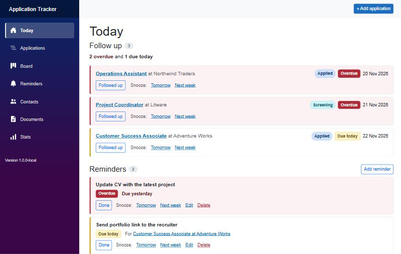
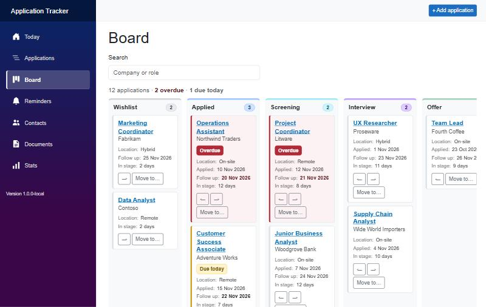
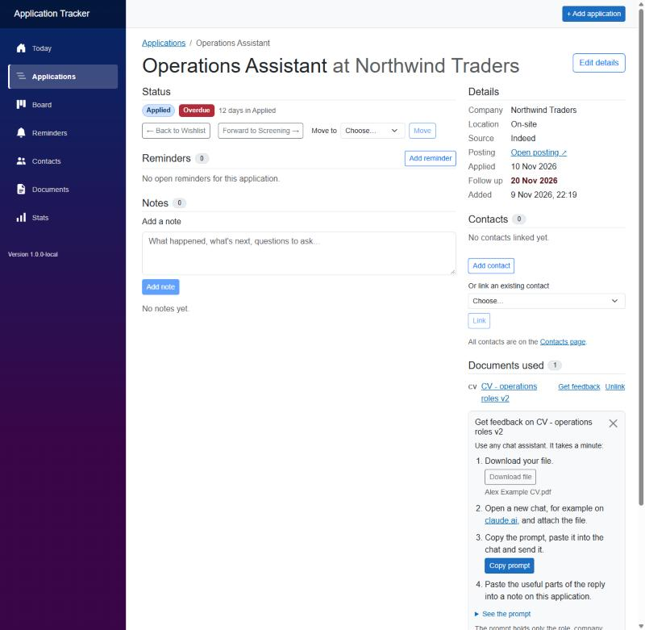
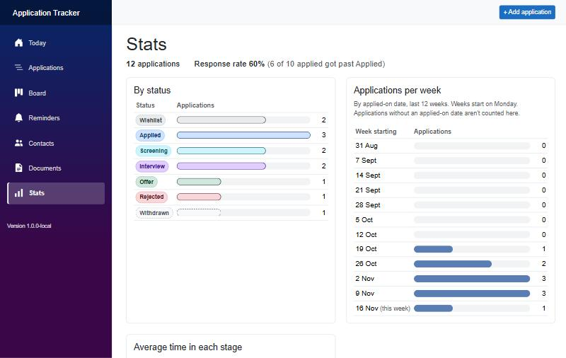

# Application Tracker

A simple, private tracker for job applications. It runs on your own Windows PC, with no account and no cloud: your data never leaves the computer.

**[Download for Windows](https://github.com/cckraken/ApplicationTracker/releases/latest)** (free, Windows 10 or 11, nothing to install). See [Download and run](#download-and-run-windows) below.

- **See where everything stands**: a board and a sortable list, from Wishlist to Offer, with every status change recorded.
- **Never miss a follow-up**: follow-up dates and reminders, with overdue and due-today items on the Today page.
- **Keep the people and the details**: contacts (recruiters, hiring managers) and timestamped notes on each application.
- **Your CV and cover-letter versions**: upload each version once and link it to the applications you used it for.
- **Feedback on your CV**: get a ready-made prompt to paste, with your CV, into a chat assistant such as claude.ai. The app itself never sends anything anywhere.
- **Stats**: counts by status, response rate, applications per week and average time in each stage.

| Today | Board |
|---|---|
|  |  |
| **CV feedback** | **Stats** |
|  |  |

*Screenshots use made-up demo data.*

## Download and run (Windows)

1. Download the latest `ApplicationTracker-…-win-x64.zip` from [Releases](https://github.com/cckraken/ApplicationTracker/releases/latest) (under **Assets**).
2. Right-click the zip and choose **Extract All**, for example into `Documents`. Don't run it from inside the zip.
3. In the extracted folder (named like the zip), double-click **`Start ApplicationTracker.cmd`**. A black window opens, and after a few seconds your browser opens at http://localhost:5180.
4. Keep the black window open while you use the app. Close it to stop the app.

The first time, Windows may say **"Windows protected your PC"**, because the app isn't signed with a paid certificate. Click **More info**, then **Run anyway**.

Want to look around first? Double-click **`Try the demo.cmd`** instead: it opens made-up demo data at http://localhost:5181 and never touches your own.

Nothing else needs installing: .NET is included. A `README.txt` in the folder repeats these steps.

## Your data and privacy

- Everything is stored in `%LOCALAPPDATA%\ApplicationTracker\data` (paste that into the File Explorer address bar): a SQLite database (`tracker.db`) and the CVs and cover letters you upload (`tracker-documents`). The demo keeps its made-up data separately, in `demo.db` and `demo-documents`.
- **Back up** by closing the app and copying the `%LOCALAPPDATA%\ApplicationTracker` folder somewhere safe. To restore, close the app and copy it back.
- **Update** by closing the app, deleting the old extracted folder (the one with the `.cmd` files) and extracting the new version. Your data stays where it is. The version is shown at the bottom of the app's menu.
- **Remove** the app by deleting the extracted folder, and the `%LOCALAPPDATA%\ApplicationTracker` folder if you also want to delete your data.
- The app only listens on `localhost`, so other computers on your network can't reach it.

## Getting CV feedback

1. Upload your CV on the **Documents** page.
2. Open an application, click **Edit details** and paste the job ad into **Job description**. Then, back on the application, link your CV under **Documents used**.
3. Click **Get feedback** and follow the steps: download your CV, open a chat assistant such as [claude.ai](https://claude.ai), attach the CV, then copy and paste the ready-made prompt.

The prompt contains only the role, company, location, job description (or the posting link) and the file's name: never your notes or contacts. Feedback stays where you choose to paste it, for example as a note on the application.

**Using Claude Code?** On the same panel, download the feedback pack (the prompt and your CV in one zip), unzip it outside the app's data folder, and ask the [`cv-reviewer`](.claude/agents/cv-reviewer.md) agent in this repository to review it.

## Built with Claude Code

This project is also an experiment in agentic engineering: it was planned, built, tested and reviewed with [Claude Code](https://claude.com/claude-code), using the project's own instructions and specialist agents. The setup is all in this repository:

- **[`CLAUDE.md`](CLAUDE.md)**: the project's ground rules. It covers the stack, the layout, and "one owner per job", where each rule (status changes, follow-up dates, stats, documents, feedback packs) lives in exactly one place in `Core` and the UI never reimplements it. It also sets the git conventions and the data-safety rules.
- **[Path-specific rules](.claude/rules/)**: extra guidance that loads only when Claude works in that area: [Blazor pages](.claude/rules/blazor-ui.md), [Core and data](.claude/rules/core-data.md) and [tests](.claude/rules/tests.md).
- **[Subagents](.claude/agents/)**: each feature runs through the same review loop, with each agent working in the background:
  - [test-writer](.claude/agents/test-writer.md) writes the tests,
  - [ui-ux-designer](.claude/agents/ui-ux-designer.md) reviews usability and accessibility,
  - [code-reviewer](.claude/agents/code-reviewer.md) looks for bugs and rule drift,
  - [agent-maintainer](.claude/agents/agent-maintainer.md) keeps these instructions in step with the code. It proposes changes to `CLAUDE.md` and the rules for a human to approve.
- **Planning first**: larger features start in plan mode with a short list of multiple-choice questions, and are delivered in small, reviewed pull requests.
- **[Hooks](.claude/settings.json)**: `dotnet format` runs on every C# file Claude edits.
- **Data safety**: deny rules keep Claude out of the real database and uploaded CVs. All development and testing uses a separate demo database and temporary folders.

The code is .NET 10 / C#: a Blazor Server UI over a `Core` library with EF Core and SQLite, plus xUnit tests.

## Run from source

You need the [.NET 10 SDK](https://dotnet.microsoft.com/download).

```powershell
dotnet build
dotnet test
dotnet run --project src/ApplicationTracker.App   # Development mode, demo data in data/tracker.dev.db
```

To make a release, push a version tag (`git tag v1.0.0` then `git push origin v1.0.0`). The [release workflow](.github/workflows/release.yml) builds and tests the code, and publishes the Windows zip to Releases.

## Licence and credits

[MIT](LICENSE). Third-party components are listed in [THIRD-PARTY-NOTICES.txt](THIRD-PARTY-NOTICES.txt).

Built by [Daniel Barrett](https://www.linkedin.com/in/daniel-barrett-624074160/).
